<div align="center">



# SENS (СЕНС)

**Експериментальна мова програмування, у якій двійкова координата є частиною семантики.**

<p><a href="https://github.com/juv4uk/sens/releases/latest"><strong>▶ Завантажити SENS CLI</strong></a></p>
<sub>Виберіть нативний CLI-артефакт для своєї платформи або Windows MSI в Assets останнього релізу. Portable Web не входить до активного SENS-only релізного набору.</sub>

[](https://github.com/juv4uk/sens/actions/workflows/ci.yml)
[](https://github.com/juv4uk/sens/actions/workflows/wasm-browser-test.yml)

**Українська — перша мова проєкту.** Типова людська поверхня CLI та Web REPL — повна проєкція `укр`; компактна `ук` лишається доступною через явний вибір.

</div>

---

**Чинне джерело:** [CURRENT.md](CURRENT.md) · Contract 11.9 · D1–D10 · D11 (окремий тестовий словник) · числова драбина D12+.
Ратифікація координат ≠ допуск до виклику ≠ доказ фізичного виконання.

## Стан на 19.10.2026: українське джерело та точні домени

Це зріз **наявних реалізацій у `main`**, а не оголошення загальної готовності SENS або нового рішення про ратифікацію.

| Ділянка | Що є зараз | Чого це **не** доводить |
|---|---|---|
| Домени | D1–D10 з ратифікованими координатами; D10 1024/1024. [D11](lib/domains/d11.lisp) містить **43 нератифіковані тестові позначення** (це не зарезервовані адреси функцій); окремо [512 похідних селекторів D11](knowledge/d11-selector-seed.json) математично визначено, але їхнє автономне виконання ще не доведено. [D7 v2](docs/d7-keyboard-v2.uk.md) — клавіатурний текст 128/128. | D11 — ще не новий callable Core; D10 **не оголошено невиконуваним**: поелементне виконання необхідно реалізувати й перевірити, не виводячи статус із кількості координат. |
| Людський `.lisp` | Виклики використовують **повні імена `укр`** із доменних таблиць; синтаксис/імена — символи української розкладки. Цифрові викличні голови й числові літерали заборонені; числові значення будуються зі спискових даних і явної арифметики. Сирі бітові голови, закодовані літерали та історичні SID8/Sens8 не є людською програмою. | Назва сама по собі не встановлює семантичної ідентичності чи викличності. |
| Математика | Звичайна проєкція **знакових десяткових цілих** починається з D12 і розширюється до найменшого потрібного D24/D48/D96/D192 домену перед виконанням `*.lisp` у CLI та REPL ([код](crates/sens/src/source_projection.rs)). Пов'язані D5-вирази узгоджують ширину; явний профіль може задати ширший мінімум. Дроби також можливі через допущені математичні операції, зокрема `частка`. | Це **не** загальна підтримка всіх десяткових дробових літералів чи чисел довільної величини: поточний reader має межу `i128` і повертає явну помилку при переповненні. |
| Фізичне представлення | `.sens` — фізичні байти **T5M** (чинний default); **T5** лишився явним legacy-маршрутом. Zig-коридор переносить точні слова до/від байтів. `.lisp` та `.sens` — різні шари. | Сам транспортний roundtrip не є доказом SENS-евалюації; повне усунення Rust-обходів не слід вважати доведеним. |
| CI | Центральний [`ci.yml`](.github/workflows/ci.yml) запускає перевірки на **GitHub-hosted Ubuntu 24.04**; чинний YAML **не містить** `concurrency`, `cancel-in-progress` чи `queue: max`, тому не гарантує ані несхлопування запусків, ані місткості черги на 100 jobs. Статуси перевіряти в GitHub Actions за точним SHA. | Колір одного workflow не встановлює статус усього проєкту; історичні бенчмарки не є поточним зеленим CI. |

**Короткий шлях перевірки (без вигаданої семантики):**

```sh
# Виконати український source-файл через справжній SENS CLI:
cargo run --locked -p sens-cli --bin sens -- path/to/program.lisp
# Перевірити саме реалізовану проєкцію цілих чисел:
cargo test --locked -p sens --lib source_projection::tests:: -- --nocapture
# Декодувати наявний фізичний файл для перегляду (не виконати):
cargo run --locked -p sens-cli --bin sens-trit -- open path/to/program.sens
```

Звичайний запуск `.lisp` і явний `--t5m-file` проходять через той самий
Zig/T5M-коридор: українська форма проєктується у точні слова, пакується T5M,
відновлюється через Zig і виконується SENS. CLI-аргументи доступні програмі
через українську змінну `параметри-командного-рядка`.

Для нової міграції потрібні **`name.lisp` → `name.sens` (байти T5M) + `name` (похідний видимий бітовий перегляд без розширення)**. Файл `name` — не ще один канонічний виконавчий формат. Старі SID8/Sens8 голови зіставляються з чинними доменами **за доведеною історичною роллю**, а не за рівністю байта з D8. [Правила міграції](docs/SENS-LISP-TO-T5-MIGRATION-2026-10-08.uk.md) · [навігація документацією](docs/README.md).

## Завантаження частин Core4

У SENS немає мовної форми `include`. Це не забороняє CLI завантажувати кілька файлів як частини однієї програми: `sens --t5m-files` читає `.lisp` шляхи в заданому порядку, проводить кожну частину через Zig/T5M і виконує всі частини в одній SENS-сесії. Визначення з попередніх файлів доступні наступним. Окремий файл-частина не обов'язково самодостатній.

Для Core4 застосовуй такий порядок; додай останнім власний файл-пробу, щоб перевірити визначення з бібліотеки:

```sh
cargo run --locked -p sens-cli --bin sens -- \
  --t5m-files \
  lib/core4-parts/core4-language.lisp \
  lib/core4-parts/core4-d6.lisp \
  lib/core4-parts/core4-codec.lisp \
  lib/core4-parts/core4-d6b.lisp \
  lib/core4-parts/core4-d8-d9.lisp \
  path/to/probe.lisp
```

Це зовнішнє завантаження файлів CLI, а не `include` у мові. Кожен фрагмент можна окремо закодувати в сталу пару `.lisp`/`.sens`; аудит перевіряє кожну таку пару. Тест `crates/sens-cli/src/repl.rs::t5m_core4_parts_load_sequentially_through_one_session` додатково перевіряє спільне завантаження у вказаному порядку; реальний CLI-прогін повернув `2` для проби `(додати-1 число-один)` після п'яти частин.


> **Історичний зріз 12.10.2026:** [проєктна картина на цю дату](docs/project-reality-2026-10-12.uk.md) і [raw evidence](evidence/benchmark-sweep-2026-10-12.json) залишаються відтворюваними свідченнями, але не описують весь поточний `main` і не засвідчують глобальний PASS.

## SENS у двох словах

SENS — це не «звичайна мова з бітовими opcode».

У SENS **точна двійкова послідовність + точна ширина + закон домену** утворюють semantic identity.

~~~text
D1 1  ≠  D2 01  ≠  D3 001  ≠  D4 0001
~~~

Число, яке можна отримати з бітів, — лише похідне представлення. 168 не стає семантичним значенням замість 10101000.

І так само байт, u8, FPGA-комірка чи інший carrier не визначає meaning.

Поточна нормативна база — **Contract 11.9**: ратифіковані D1–D9, цілісний домен **D10 1024/1024** (акт 12.10.2026), а також числове сімейство **D12/D24/D48/D96/…** (уточнення 24.10.2026). **Власник вимагає реального виконання всіх функціональних резидентів SENS.** Для D10 це означає послідовне завершення SENS-визначень, реальних механізмів і позитивних/негативних фізичних свідків. Відсутність окремого доказу означає `NOT_VERIFIED`, **не** «невиконувано»; T5M лише перевозить точні слова. Перехід самого `language-contract.lisp` до canonical visible-binary source ще триває в **#4248**; цей README описує цільову binary-source модель, а не оголошує незавершений cutover завершеним.

---

**Історичний замір 09.10.2026 (GitHub-hosted, без нової семантики):** потокове кодування legacy T5 — **109 → 70 нс/виклик** для 1 D3 QUOTE і **48 896 → 47 852 нс/виклик** для 1024 форм (побайтова тотожність до заміру, same-run paired control); доменна зайнятість D3 — **25,069 → 3,746 нс/звернення**, D7 — **132,771 → 5,326 нс/звернення** (D3–D7 бітмаски та O(1) lookup, але *різні* hosted-прогони, не контрольований A/B). Це не замір T5M і не опис поточного default. [SHA, p50/p95, legacy T5 raw evidence](benchmarks/physical-sens-runtime/streaming-t5-baseline-2026-10-09.md) · [SHA та методика occupancy](docs/benchmarks/2026-10-09-domain-occupancy-bitmask.uk.md). **Це швидкість окремих механізмів, не всієї мови; червоні Hosted CI/Vertical Day не скасовані.**

### Файлова та виконавча влада

Канонічне розширення вихідного коду — **`.lisp`**. У поточній українській проєкції це людський запис `укр`; семантичну тотожність задають точні двійкові слова, ширини та ратифіковані домени, а не назви функцій.

**`.wsm`** і **`.my`** — історичні псевдоніми розширення (*legacy aliases*) для сумісності. Вони не створюють інших семантичних законів.

**Rust — референсна реалізація** (*reference implementation*) для перевірюваного виконання, кодера/декодера й тестових оракулів. Rust, компілятор і жоден backend **не** визначають семантику SENS: її влада походить від ратифікованих законів і виконуваних свідчень; див. [карту семантичної влади](docs/semantic-authority-map.md).

## Фізичні кодеки: семантика SENS одна, носії різні

Фізичний кодек **не створює іншу мову**. Чинний T5M,
Frame3 Carrier (F3C) і Frame3-Micro (F3M) мають відновити ті самі точні доменні слова; після
декодування вони передаються тому самому канонічному SENS reader/evaluator.

| Назва | Носій | Статус / роль |
|---|---|---|
| **T5M** | `.sens` | чинний загальний фізичний transport; production default |
| **T5** | історичні дані та provenance | не є активним кодеком або маршрутом виконання |
| **Frame3 Carrier (F3C)** | `.senc` | явно вибраний компактний carrier для дуже малих програм; історичні CLI/докази ще використовують коротку назву `F3` |
| **Frame3-Micro (F3M)** | `.f3m` | bounded dense micro-rank: сімейство вибирається явно, а профіль визначає **довжина 1/2/3/4/5 байтів**; без внутрішньої magic/version мітки |
| **Envelope E1/E2/E3** | research carriers | самодостатні metadata-heavy оболонки, історично `S3/v1-v3`; це **не версії Frame3** |

Повна нормативна матриця режимів: [**режими проєкту SENS**](docs/project-modes-2026-10-12.uk.md).

Однобайтовий доказ не є моделлю іншої семантики: committed файл
`research/framed3/fixtures/car-cons-one-nil.f3m` містить **один байт
`0x3E`**, dense F3M-декодер відновлює точні слова
`10 100 10 111 1 000 01 01`, а реальний SENS evaluator виконує їх як
`CAR(CONS(1,NIL))` з паритетом до чинного T5M. Отже це **фізичне кодування SENS**,
а не окрема мова.

Межа доказу принципова: F3M не містить внутрішньої magic/version мітки.
Сімейство вибирається зовнішнім маршрутом, а **профіль визначає тільки точна
фізична довжина**: 1 байт = F3M-1, 2 = F3M-2, 3 = F3M-3,
4 = F3M-4, 5 = F3M-5; 0 і 6+ зараз відхиляються fail-closed. Вміст байтів не
sniff-иться й не перемикає профіль, тому всі 8/16/24/32/40 бітів лишаються
програмному рангу. Чинний dense F3M-1
використовує **всі 256/256 кодів** як унікальні замкнені виконувані програми;
F3M-2 займає наступні **65 536** global ranks і має exhaustive payload roundtrip;
F3M-3 займає наступні **16 777 216** ranks, має real-evaluator witnesses,
DP-доказ першого 6/6-capability коду `16 3C 63` та exhaustive-пошук останньої
64K-сторінки з переможцем `FF FB 37`. F3M-4 займає наступні
**4 294 967 296** ranks; для нього вже є algebraic capacity proof,
65 536 stratified roundtrip samples і реальний executable witness
`DE AD BE EF`. F3M-5 додає окремий prefix-stable extension-space на
**2^40 = 1 099 511 627 776** payloads: старі F3M-1..4 ranks не зсуваються,
а кожен F3M-5 вираз містить щонайменше новий `EQ` або `LAMBDA`.
65 536 stratified roundtrip samples по 40-бітному простору та executable
witness `03 B1 C7 07 93` із усіма D1–D3 capability-класами + LAMBDA
проходять чинний proof gate. Повні evaluator sweeps 2^32/2^40 не заявляються.
Окремі **дослідні** F3M-5λ та F3M-5λA додають безіменні лексичні посилання
де Брейна та внутрішнє застосування функцій: `00 00 00 02 4B` виконує
`(λx.x) 1`, а `00 00 0D 06 4F` — `((λx.λy.x) 1) 0`; обидва повертають
точний D1 `1` у справжньому SENS evaluator. Це **не** інше трактування
чинного `.f3m` F3M-5 і **не** production admission: закон `BOUND(n)` ще
потребує канонічної ратифікації. Деталі:
[профілі F3M за довжиною](docs/frame3-micro-length-profiles-2026-10-12.uk.md) ·
[назви фізичних кодеків](docs/codec-naming-2026-10-12.uk.md).

---

## `.sens`: трійкова межа всередині, звичайний пробіл назовні

**Мова залишається строго двійковою.** Фізичний файл `.sens` пакує T5M (транспортні трити `0/1/2`, п'ять тритів на фізичний байт). Історичний T5 зберігається лише як provenance, не як активний compatibility-маршрут. `2` означає лише межу доменних слів: декодер показує її як **звичайний пробіл**. **Окремого завершувача `22` немає:** кінець визначає сам файл, у фінальному байті можуть бути лише 0–4 трити `2` для доповнення.

~~~text
Двійкові слова:  10 | 001 | 00 | 000 | 01
Перегляд .sens:  10 001 00 000 01
~~~

~~~shell
cargo run -q -p sens-cli --bin sens-trit -- encode path/program.lisp
cargo run -q -p sens-cli --bin sens-trit -- open path/program.sens

# Фізична двійкова програма виконується без текстового Lisp-парсера:
cargo run -q -p sens-cli --bin sens -- tests/fixtures/migration-quote-cohort-main/quote-legacy.sens

# Еквівалентний явно викликаний чистий evaluator:
cargo run -q -p sens-cli --bin sens-trit -- eval tests/fixtures/migration-quote-cohort-main/quote-legacy.sens
~~~


**Поточна виконавча межа:** `sens file.sens` читає фізичні T5M-байти, перевіряє канонічну D2-структуру й передає точні доменні слова чинному SENS-виконавцю **без** текстового Lisp-reader, неявного Core4-bootstrap або host capabilities. `sens-trit open file.sens` тільки показує бітовий перегляд, не виконує його. `sens-trit eval-core4 file.sens` є окремим *явним* запитом завантажити Core4, а не наслідком відкриття файлу. Недопущені закони чи дефектний транспорт викликають відмову; чистий CLI-запуск сам по собі не є доказом історичної/української semantic-oracle parity. Перевірка механіки — [Physical binary SENS CLI smoke](.github/workflows/physical-binary-sens-cli.yml).

**Правило міграції репозиторіїв:** існуючий `каталог/назва.lisp` має відповідник `каталог/назва.sens` із байтами чинного T5M-кодека. Транспортна `2` розділяє точні двійкові слова. Створювати **третій однойменний файл `каталог/назва` без розширення** як похідний перевірюваний перегляд точних бітових слів `0/1`, розділених **одним ASCII-пробілом**, із одним завершальним LF. Не зберігати текст `0/1/2` у `.sens` і не підміняти фізичні байти видимим бітовим записом. `.lisp`, `.sens` і файл-view мають проходити спільний перевірений roundtrip; сам лише транспортний view **не підтверджує семантичного допуску**. [Міграція `.lisp → .sens`](docs/SENS-LISP-TO-T5-MIGRATION-2026-10-08.uk.md), [координація агентів #4449](https://github.com/juv4uk/sens/issues/4449).

Файл `.sens` **фізично двійковий**, не ASCII. `open/view` декодує його у текст для людини; звичайному редактору потрібен окремий codec provider або file association. Деталі історичного T5 wire та сумісного перегляду: [T5 `.sens` — відображення пробілів](docs/sens-t5-space-view.uk.md). Формальна ратифікація всього wire-v1, зокрема EOS, лишається окремою задачею #4444.

---
## Історична мить: Rule B — 10 жовтня 2026

**Перше слово (`10`) злите з відкриваючою дужкою, останнє (`01`) — із закриваючою.**  
Транспортна `2` стоїть **лише між внутрішніми словами**.

Це правило (Rule B) замінює попереднє Rule A (`10 2 … 2 01` з `2` між усіма). Результати на 5000 валідних D2-програм (1–5 рівнів вкладеності):

| Кодек у замірі 10.10 | Розмір | Економія vs legacy T5 baseline | Перемоги |
|---|---|---|---|
| T5 (тодішній `.sens` baseline; нині legacy) | 46 327 Б | — | 0/5000 |
| **Frame3 Carrier (`.senc`, F3C; історично F3)** | **37 837 Б** | **−18.3%** | **5000/5000** |

- Мінімальна рамка: **4 трити** (`1001` → `F3 00`) — порожня структура `10 01`.
- 1 байт тіла (`F3 XX`): 4–8 трит, **94 програми** (атоми 1–4 біт).
- 2 байти (`F3 XX YY`): 9–14 трит, **39 276 програм** — повноцінні D2-форми з 2–5 внутрішніми атомами.
- У вимірі канонічний для того часу legacy T5 для `(10 10 00 01 01)` = 16 трит (4 Б); Frame-3 = 12 трит (3 Б) — **3× стиснення**.

Це датований замір legacy T5 Rule A, не опис чинного default: нині `.sens` використовує T5M; історичні результати та raw evidence не переписуються. Дослідницький Frame3 Carrier живе в `research/framed3/` (Rule B).

---
## Незалежна перевірка: dense F3M-1 використовує всі 256 байтів

**Чинний активний F3M-1 — щільний enumerative profile: 256/256 фізичних
байтових кодів відповідають 256 різним замкненим SENS-програмам.** Жодне
значення байта не резервується під magic/version: профіль визначає сама
фізична довжина файла.

Канонічний legacy-порядок спільний для F3M-1/F3M-2/F3M-3/F3M-4: програми впорядковуються
за розміром дерева, потім за конструктором, розбиттям піддерев і локальними
рангами. Профілі беруть **неперетинні вікна** цього глобального порядку:

- F3M-1: глобальні ранги `0..255` — **256 програм**;
- F3M-2: наступні `65 536` рангів;
- F3M-3: наступні `16 777 216` рангів;
- F3M-4: наступні `4 294 967 296` legacy-рангів;
- F3M-5: **2^40** rank-ів окремого prefix-stable extension-space з D3 EQ і D4 LAMBDA.

F3M-5 не вставляє нові конструктори всередину старого global order: це окремий
ранкер лише для виразів, що містять EQ або LAMBDA, тому F3M-1..4 залишаються
байт-в-байт незмінними.

Через неперетинні вікна одна програма не має одночасно 1-, 2- і 3-байтового
канонічного запису: `encode(decode(bytes)) == bytes` і encoder завжди
повертає найкоротший доступний F3M-профіль.

### Однобайтовий трофей

Файл
[`car-cons-one-nil.f3m`](research/framed3/fixtures/car-cons-one-nil.f3m)
має рівно **1 байт `0x3E`**. Dense enumerator відновлює точні слова

~~~text
10 100 10 111 1 000 01 01
~~~

тобто `CAR(CONS(1,NIL))`. Програма проходить канонічний Rust reader,
реальний SENS evaluator і незалежний фізичний legacy T5-свідок; у цьому
історичному T5 ті самі слова займають 5 байтів.

Попередній дослід 11.10.2026 використовував sparse mapping
`0x45 → CAR(CONS(1,NIL))` і допускав лише 45/256 кодів. Його benchmark
artifact збережено **історично** для відтворюваності, але це вже не активна
F3M-1 таблиця.

### Круті програми, які реально поміщаються в 1–5 байтів

Це не намальовані opcode-приклади: для **F3M-1..5** наведено
перевірені фізичні свідки чинних профілів; **F3M-5λ / F3M-5λA** —
окремі дослідні ранкери зі справжніми лексичними замиканнями й викликами,
підтвердженими реальним SENS evaluator. **Однакові 5 байтів у цих
різних ранкерах можуть означати різні програми**: дослідні байти не можна
неявно відкривати production F3M-5 декодером. Назви функцій та λ у таблиці —
лише людський перегляд точних доменних ідентичностей.

| F3M | Байти | Програма | Що в ній крутого | Результат |
|---|---|---|---|---|
| **F3M-1** | `1A` | `CONS(1,NIL)` | ціла пара/спискова комірка в **1 байті** | pair `(1 . NIL)` |
| **F3M-1** | `3E` | `CAR(CONS(1,NIL))` | побудова пари + вибір першого елемента в **1 байті** | `1` |
| **F3M-1** | `67` | `CDR(CONS(NIL,1))` | побудова пари + вибір другого елемента в **1 байті** | `1` |
| **F3M-1** | `83` | `ATOM(ATOM(ATOM(QUOTE(NIL))))` | рекорд глибини F3M-1 census: **4 рівні дерева** | `1` |
| **F3M-1** | `CB` | `ATOM(CAR(CONS(QUOTE(NIL),QUOTE(NIL))))` | **QUOTE + ATOM + CONS + CAR**: 4 capability-класи, 5 encoded-операцій | `1` |
| **F3M-1** | `EF` | `ATOM(CDR(CONS(QUOTE(NIL),QUOTE(NIL))))` | найвиразніший F3M-1 за нашою метрикою: **QUOTE + ATOM + CONS + CDR**, 4 класи, 5 encoded-операцій | `1` |
| **F3M-2** | `00 C8` | `IF-ATOM(0,0,0)` | **найперший двобайтовий COND** у canonical rank order | `0` |
| **F3M-2** | `FC 25` | `ATOM(CAR(CONS(QUOTE(NIL),IF-ATOM(QUOTE(NIL),QUOTE(NIL),QUOTE(NIL)))))` | переможець exhaustive census усіх **65 536** двобайтових програм: 5/6 capability-класів, 1 COND, 9 encoded-операцій | `1` |
| **F3M-2** | `FB 4D` | `ATOM(CAR(CONS(QUOTE(NIL),CDR(CONS(ATOM(QUOTE(NIL)),QUOTE(NIL))))))` | одночасно **CAR + CDR + CONS + QUOTE + ATOM** у 2 байтах | `1` |
| **F3M-2** | `BB 51` | `ATOM(ATOM(ATOM(ATOM(ATOM(ATOM(QUOTE(NIL)))))))` | рекорд глибини двобайтового census: **7 рівнів** | `1` |
| **F3M-3** | `16 3C 63` | `CAR(CONS(0,CDR(CONS(0,IF-ATOM(0,0,QUOTE(0))))))` | **найраніший** rank, де вже є всі 6/6 класів: QUOTE+ATOM+CONS+CAR+CDR+COND | `0` |
| **F3M-3** | `2F 18 59` | `IF-ATOM(QUOTE(0),CAR(CONS(QUOTE(1),1)),CDR(CONS(QUOTE(NIL),QUOTE(0))))` | компактне реальне умовне обчислення з двома різними гілками | `1` |
| **F3M-3** | `FF FB 37` | `CAR(CONS(CDR(CONS(1,QUOTE(1))),ATOM(IF-ATOM(QUOTE(NIL),QUOTE(NIL),QUOTE(NIL)))))` | переможець exhaustive-пошуку останньої 64K-сторінки; 6/6 класів, 1 COND, 11 encoded-операцій | `1` |
| **F3M-4** | `DE AD BE EF` | `ATOM(CONS(ATOM(CDR(CONS(QUOTE(0),CAR(CONS(NIL,QUOTE(0)))))),ATOM(ATOM(ATOM(QUOTE(NIL))))))` | **12 micro-nodes у 4 байтах**; canonical parse + real evaluator + exact roundtrip | `0` |
| **F3M-4** | `0D E5 67 30` | `IF-ATOM(0,0,IF-ATOM(0,0,IF-ATOM(0,0,0)))` | **максимум 3×COND** для F3M-4; четвертий COND потребував би ≥13 nodes | `0` |
| **F3M-4** | `BA BF 19 4E` | `ATOM(ATOM(ATOM(ATOM(ATOM(ATOM(ATOM(ATOM(ATOM(ATOM(ATOM(0)))))))))))` | абсолютна межа глибини: **12 рівнів / 12 nodes** | `1` |
| **F3M-4** | `F5 A7 BC 39` | `ATOM(CAR(CONS(QUOTE(0),CDR(CONS(QUOTE(0),IF-ATOM(QUOTE(0),QUOTE(0),IF-ATOM(QUOTE(0),QUOTE(0),QUOTE(0))))))))` | metric-saturating witness: **6/6 класів, 2×COND, 16 encoded-операцій, depth 6, 12 nodes** | `1` |
| **F3M-5** | `03 B1 C7 07 93` | `IF-ATOM(EQ(ATOM(LAMBDA((),QUOTE(0))),ATOM(QUOTE(1))),CAR(CONS(QUOTE(0),CDR(CONS(QUOTE(1),QUOTE(NIL))))),QUOTE(NIL))` | **усі D1–D3 capability-класи + LAMBDA** в одному 5-байтному executable witness | `0` |
| **F3M-5λ (research)** | `00 00 00 00 00` | `λ.BOUND(0)` | **справжня nameless identity-функція**: `BOUND(0) → Local{depth:0,index:0}`, D4 LAMBDA; `λx.x = λy.y = λfoo.foo` | повертає аргумент |
| **F3M-5λ (research)** | `00 00 00 00 10` | `λ.λ.BOUND(1)` (**K**) | замикання з двома аргументами; повертає перший | `K a b = a` |
| **F3M-5λ (research)** | `00 00 00 00 0F` | `λ.λ.BOUND(0)` (**KI**) | замикання з двома аргументами; повертає другий | `KI a b = b` |
| **F3M-5λ (research)** | `05 61 69 CB 4A` | nameless 11-node witness | **QUOTE+ATOM+CONS+CAR+CDR+EQ+COND+LAMBDA**, виконано canonical SENS evaluator-ом | exact D1 `0` |
| **F3M-5λA (research)** | `00 00 00 02 4B` | `APPLY(λ.BOUND(0),1)` | самодостатня **β-редукція**: I застосовується до D1 `1` прямо з 40-бітного payload | exact D1 `1` |
| **F3M-5λA (research)** | `00 00 0D 06 4F` | `APPLY(APPLY(λ.λ.BOUND(1),1),0)` | вкладене застосування **K**; лексичне замикання зберігає перший аргумент | exact D1 `1` |
| **F3M-5λA (research)** | `00 00 3F EA 96` | **B** = `λf.λg.λx.f(g x)` | композиція функцій; 8 вузлів | `B I I x = x` |
| **F3M-5λA (research)** | `00 00 3F F9 F2` | **C** = `λf.λx.λy.f y x` | перестановка аргументів; 8 вузлів | `C K 0 x = x` |
| **F3M-5λA (research)** | `00 27 73 55 DA` | **S** = `λf.λg.λx.f x (g x)` | три замикання і три застосування; 10 вузлів | `S K K x = x` |
| **F3M-5λA (research)** | `00 00 05 24 5D` | **W** = `λf.λx.f x x` | дублювання аргументу; 7 вузлів | `W K x = x` |
| **F3M-4** | `BA AD F0 0D` | `IF-ATOM(IF-ATOM(CDR(CONS(CAR(CONS(QUOTE(NIL),QUOTE(NIL))),NIL)),1,1),0,QUOTE(0))` | красивий hex-код випадково дав **6/6 класів + 2×COND** | `0` |
| **F3M-4** | `FE ED FA CE` | `ATOM(CAR(CONS(IF-ATOM(1,0,QUOTE(NIL)),IF-ATOM(QUOTE(NIL),QUOTE(NIL),CAR(CONS(QUOTE(1),NIL))))))` | ще один mnemonic hex: **2×COND, 13 encoded-операцій** | `1` |
| **F3M-4** | `FF FF 4F 4F` | `ATOM(CAR(CONS(CAR(CONS(0,ATOM(ATOM(QUOTE(NIL))))),IF-ATOM(ATOM(QUOTE(NIL)),QUOTE(NIL),QUOTE(NIL)))))` | переможець exhaustive-пошуку останньої **64K** сторінки F3M-4 | executes |

Для F3M-1 перебрано **всі 256/256 payloads**. Усі вони унікальні,
канонічно roundtrip-яться й проходять реальний evaluator. Найвиразніший
однобайтовий код за тією самою метрикою — `EF`; найкращий CAR-випадок —
`CB`; рекорд глибини — `83`. У F3M-1 **немає жодного COND**:
умовне розгалуження починається вже з F3M-2, де перший canonical COND —
`00 C8`.

Для F3M-2 перебрано **всі 65 536/65 536 payloads**. Метрика «найвиразнішого»
фіксована й прозора: capability diversity → COND count → encoded-operation
count → depth → exact-word count → node count → later rank. За нею `FC 25`
перемагає весь двобайтовий простір. Окремо збережено категорії першого COND,
CAR+CDR і максимальної глибини, бо «крутість» не зводиться до одного числа.

Для F3M-3 `FF FB 37` — не глобальний максимум по всіх 16M кодах, а
переможець **exhaustive останньої сторінки `FF 00 00..FF FF FF`**.
Повний evaluator sweep усіх 16 777 216 F3M-3 програм лишається окремим
proof gate.

Для F3M-4 фізичний простір має **4 294 967 296** локальних rank-ів. Повний
перебір 2^32 тут не видається за виконаний: натомість є algebraic count proof,
boundary cases, **65 536 stratified roundtrip samples** по всьому 32-бітному
простору і реальний 12-вузловий `DE AD BE EF` witness.

Додатковий структурний пошук довів межі самої microgrammar в цьому вікні:
F3M-4 доходить лише до 12 nodes, тому **3 COND — абсолютний максимум**.
Якщо одночасно вимагати всі 6 capability-класів
`QUOTE+ATOM+CONS+CAR+CDR+COND`, то максимум — **2 COND**: третій разом із
CAR і CDR потребував би щонайменше 14 nodes. `F5 A7 BC 39` насичує цю
межу й одночасно досягає 16 encoded-операцій, depth 6 і 12 nodes.
Окремо exhaustive перевірено всю останню сторінку
`FF FF 00 00..FF FF FF FF`; її переможець — `FF FF 4F 4F`.

Evidence: [F3M-1 exhaustive census run 38196658709](https://github.com/juv4uk/sens/actions/runs/38196658709) ·
[F3M-2 exhaustive census + pinned regression run 38196520171](https://github.com/juv4uk/sens/actions/runs/38196520171) ·
[F3M-3 final-page proof run 38195272188](https://github.com/juv4uk/sens/actions/runs/38195272188) ·
[F3M-4 dense 32-bit proof run 38197907496](https://github.com/juv4uk/sens/actions/runs/38197907496).
[F3M-4 extremes + final-64K search run 38198382120](https://github.com/juv4uk/sens/actions/runs/38198382120).
[F3M-5λ nameless/de-Bruijn + real SENS runtime proof run 38260383334](https://github.com/juv4uk/sens/actions/runs/38260383334) — SUCCESS. Цей proof **не змінює** чинний F3M-5 mapping: F3M-5λ поки окремий research candidate, без production routing і без заяви exhaustive 2^40 sweep.
[F3M-5λA: β-редукція та вкладені APPLY на реальному SENS, run 38263454497](https://github.com/juv4uk/sens/actions/runs/38263454497) — SUCCESS; boundary checks і **65 536** стратифікованих roundtrip-зразків у 40-бітному просторі, не повний exhaustive 2^40 evaluator sweep. [Код та тести](crates/sens/src/frame3_micro_v5_lambda_app.rs) · [документовані межі й докази](docs/project-modes-2026-10-12.uk.md).
**Нові B/C/S/W:** п'ятибайтові коди та закони вище зафіксовано в точковому
дослідному тесті `five_byte_bcsw_exact_sens_reduction`; він перевіряє
зворотний ранг, точні 5 фізичних байтів і виконання `B I I x`, `C K 0 x`,
`S K K x`, `W K x` для обох значень D1 справжнім evaluator SENS.
**PASS:** [автоматичний proof run 38471870869](https://github.com/juv4uk/sens/actions/runs/38471870869), test_id `frame3-bcsw-five-bytes` (реальний SENS evaluator, точні 5-байтові коди та зворотне ранжування); тест виконується в **одному наявному push workflow**, без нового автоматичного workflow.
П'ятибайтовим є **сам комбінатор**, не весь тестовий вираз із зовнішніми аргументами.
Для цілеспрямованого відтворення без запуску всіх тестів: `cargo test --locked -p sens frame3_micro_v5_lambda_app::tests -- --nocapture`. Визначення семантики залишається за канонічним SENS, а Rust тут перевіряє носій і parity.

### Відтворення

~~~sh
cargo test -p sens frame3_micro_enumerator::tests -- --nocapture
cargo run -p sens --example frame3_one_byte_research
~~~

Перший тест перевіряє dense rank/unrank, включно з exhaustive roundtrip усіх
65 536 F3M-2 payloads, вибірковими межами F3M-3 та 65 536 stratified F3M-4 samples. Другий перебирає всі
256 F3M-1 байтів і для кожного вимагає unique roundtrip, canonical SENS parse,
реальне виконання та parity з історичним фізичним T5-свідком.


---

## Подивімося на саму мову

Ось маленька програма, у якій **весь executable source можна побачити як точні двійкові слова**.

Людська форма:

~~~lisp
(CAR (CONS () ()))
~~~

Це означає:

> взяти CAR від пари, у якій обидва елементи — порожня структура.

Канонічна видима двійкова форма:

~~~text
10 100 00 10 111 00 000 00 000 01 01
~~~

Тут немає ні #b..., ні рядків "101", ні десяткових semantic IDs.

Розбираємо послідовність:

~~~text
10    D2 open
100   D3 CAR
00    D2 separator

10    D2 open
111   D3 CONS
00    D2 separator
000   D3 empty
00    D2 separator
000   D3 empty
01    D2 close

01    D2 close
~~~

Тобто структура програми видно прямо з бітів:

~~~text
10 [100 00 10 [111 00 000 00 000] 01] 01
~~~

А semantic words мають **різну ширину там, де цього вимагає домен**:

~~~text
D2 = 2 біти
D3 = 3 біти
~~~

Результат цієї програми — D3 000, тобто порожня структура.

### Те саме іншою surface-мовою

Людські surface names — лише проекції. Наприклад, current Ukrainian surface може записати ту саму операцію як:

~~~lisp
(перше (сполучити () ()))
~~~

Семантична програма при цьому не стає іншою. Після canonical lowering вона приходить до тієї самої двійкової identity.

---

## Чотири фундаментальні речі

### 1. D2 задає форму

D2 не містить Core-функцій. Він описує структуру source:

~~~text
00  separator
01  close
10  open
11  dot
~~~

Наприклад:

~~~text
10 100 00 000 01
~~~

має відкрити форму, покласти туди D3-word 100 і закрити її.

11 — саме D2 dot. Воно не є «ще одним opcode».

### 2. D3 задає фундамент мови

Поточний D3:

| Біти | Meaning | Surface |
|---|---|---|
| 000 | порожня структура | `()` |
| 001 | QUOTE | як-є |
| 010 | ATOM | атом? |
| 011 | CDR | решта |
| 100 | CAR | перше |
| 101 | EQ | тотожне? |
| 110 | COND | за-умовою |
| 111 | CONS | сполучити |

Ці координати — **current authority**, а не старі prefix-tree експерименти.

### 3. Ширина є частиною identity

Не можна зробити так:

~~~text
001 → 1 → byte 1
~~~

і потім забути, що це був D3.

Правильно:

~~~text
(D1, 1)
(D2, 01)
(D3, 001)
(D4, 0001)
~~~

— чотири різні exact-width identities.

### 4. Carrier не є семантикою

У пам'яті D3 може фізично лежати в u8.

На FPGA D3 може потрапити у ширшу BRAM word.

У WASM воно може пройти через integer type.

Це нічого не змінює:

~~~text
semantic width  ≠  physical carrier width
~~~

---

Історія назви: проєкт починався під робочою назвою `my-lisp`, поточне ім'я — SENS. Ратифікація D9: **owner-ratified #4008**. Чинні таблиці людських поверхонь: [D1](lib/domains/d1.lisp), [D8](lib/domains/d8.lisp), [D9](lib/domains/d9.lisp). Для D10 нормативні координати й декларації законів наведено в [канонічному інвентарі](knowledge/d10-v18-semantic-inventory.json), а статус рішення — в [акті власника](knowledge/d10-owner-whole-domain-ratification-20261012.json). Жоден транспорт, зокрема T5M, сам по собі не надає автоматичного допуску до виклику.

## D1–D10, тестовий D11 та числові D12+

SENS будує не одну плоску таблицю opcode, а **драбину доменів**.

| Домен | Ширина | Роль |
|---|---:|---|
| D1 | 1 | точний PredicateBit |
| D2 | 2 | структура source |
| D3 | 3 | фундамент Core |
| D4 | 4 | bootstrap |
| D5 | 5 | наступний exact-width semantic domain |
| D6 | 6 | наступний exact-width semantic domain |
| D7 | 7 | чинна клавіатурна/text-data v2, 128/128; історична звукова v1 — окреме джерело |
| D8 | 8 | повний owner-ratified domain |
| D9 | 9 | повний owner-ratified domain |
| D10 | 10 | весь каталог 1024/1024 ратифіковано; окремі докази механізмів і виклику залишаються відкритими |
| D12+ | 12·2^n | ратифіковані числові домени D12/D24/D48/D96/D192/… |

Поточна owner-ratified картина:

~~~text
D7 = 128/128 ratified keyboard/text v2; historical sound v1 was 126/128
D8 = 256/256
D9 = 512/512
D10 = 1024/1024, whole-domain owner-ratified; residency alone grants no callability
D12+ = owner-ratified numeric ladder
~~~

**Чинна D7:** [ратифікована клавіатурна таблиця v2](knowledge/d7-keyboard-v2-ratified.json) від 13.10.2026 з усіма 128 точними семибітовими координатами. Два історично резервні місця `0100001` і `0101010` належали лише звуковій v1. **За D7 v1 нічого не було мігровано**, тому для нинішньої міграції немає старих v1-даних, які потрібно декодувати чи перекодовувати: одразу застосовується чинна D7 v2. D7 — текстові дані, не арифметика чи право виклику функції. [Опис чинного профілю](docs/d7-keyboard-v2.uk.md).

D9 має окремий runtime-carrier ланцюг. Це механізм розміщення, а не привід звести D9 назад до D8/SID8.

---

## Як виглядає справжня binary source

Канонічний source має містити **лише видимі біти та синтаксичні розділення**.

Добре:

~~~text
10 100 00 10 111 00 000 00 000 01 01
~~~

Не є канонічним semantic source:

~~~text
#b100
"100"
4
168
Sid8(168)
Function8(...)
~~~

Останні форми можуть існувати як compatibility, tooling або host representation, але вони не повинні ставати authority для current SENS source.

---

## Чому 00, 01, 10, 11 не плутаються з D3

Двобітні слова належать **D2**.

Трибітні слова належать **D3**.

Тому:

~~~text
10  ≠  010
01  ≠  001
11  ≠  111
~~~

10 — D2 open.

010 — D3 ATOM.

11 — D2 dot.

111 — D3 CONS.

Саме тому SENS не намагається вирівняти все до одного 8-бітного поля.

---

## Як мова росте

SENS не хоче вручну роздати meaning кожному вільному бітовому шаблону.

Потрібен закон:

~~~text
корінь
  ↓
закон
  ↓
породження
  ↓
witness
  ↓
falsifier / negative cases
  ↓
ratification
~~~

Для selector-family це особливо наочно. У current D3:

~~~text
100 = CAR
011 = CDR
~~~

Але подальший selector не можна призначати тільки через «схожість бітів». Кожна family-law має бути окремо доведена або ратифікована.

Отже:

> **геометрія допомагає знайти закон; вона не замінює закон.**

---

## Канонічний pipeline

~~~text
human / symbolic surface
        ↓
domain-aware parser
        ↓
exact-width semantic objects
        ↓
domain laws / evaluator
        ↓
IR / lowering
        ↓
Rust / WASM / C / FPGA / other substrate
~~~

Назва CAR, перше, aṇu або інша surface-форма не є semantic authority.

Так само backend не має права сказати:

> «у мене opcode 100, отже це CAR».

Правильний напрямок інший:

> «семантика вже визначила exact D3:100; backend лише обирає механізм виконання».

---

## Українська surface

Українська — основна surface-мова SENS.

Поточні короткі програмні імена:

~~~text
порожнє
як-є
атом?
решта
перше
тотожне?
за-умовою
сполучити
~~~

Повні назви та інші поверхні зберігаються окремо:

~~~text
ук → укр → san → en → LISP → sym
~~~

Surface можна повністю перейменувати без зміни semantic identity.

---

## Інструменти для двійкової мови

У репозиторії вже є корисне tooling-ядро.

### Legacy-маршрут міграції та admission

Поточний фізичний default для нових `.sens` — **T5M**; основний мігратор
`scripts/migrate-three-pass.py` також має `--codec t5m` за замовчуванням.
Нижченаведений `scripts/migrate.py` — окремий сумісний legacy-маршрут: він
працює з T5 і не повинен підміняти T5M у нових канонічних файлах. Поточний
облік пар та меж допуску: [зведення прогресу міграції](docs/T5-MIGRATION-PROGRESS.uk.md).

**Запускайте з кореня репозиторію:** `scripts/migrate.py` — сумісний
legacy-маршрутизатор до трипрохідного перекладу, legacy T5-кодека,
Git-атестації й SENS Rust-оракула. Він не додає нових функцій
мови, не конвертує непідтверджені символи за схожістю назв і не пише в
`main` автоматично.

~~~bash
# 1. Назви конкретних ще не допущених файлів та причини, БЕЗ запису
python3 scripts/migrate.py candidates --report /tmp/sens-candidates.json

# 2. Пробний запуск справжнього мігратора на ОДНОМУ старому файлі
python3 scripts/migrate.py preview benchmarks/lists.lisp \
  --mirror /tmp/sens-preview --report /tmp/sens-preview.json
# Якщо повернуло BLOCKED — потрібний доказ/закон, а НЕ вимкнення захисту

# 3. Збірка Rust D2 рідера для legacy admission tool
cargo build -p sens-cli --bin sens-trit

# 4. Legacy-допуск: source→T5→oracle (не чинний T5M default)
python3 scripts/migrate.py admit \
  --manifest /tmp/approved-original-proof.json \
  --mirror /tmp/sens-approved \
  --reader target/debug/sens-trit \
  --report /tmp/sens-admission.json

# 5. Лише якщо попередній звіт VERIFIED_NOT_WRITTEN
python3 scripts/migrate.py admit \
  --manifest /tmp/approved-original-proof.json \
  --mirror /tmp/sens-approved \
  --reader target/debug/sens-trit \
  --report /tmp/sens-written.json --write
~~~

`preview` ніколи не має `--write`. Публікація доступна **тільки**
через `admit --write`: маніфест фіксує вихідний Git blob,
фізичний SHA256, typed-word SHA256 і команди незалежного оракула.
Запис — лише нового файла `name.sens` у зовнішньому mirror; старий
`name.lisp` зберігається, перезапис заборонено. Результат
`BLOCKED` не вважати міграцією. Нові контрольні приклади не рахувати
як перенесення старих файлів.

Для цього legacy admission tool обов'язкові три окремі класи доказів: **правильні T5-байти,
валідна D2-структура, семантична еквівалентність у незалежному оракулі**.
Це сумісний legacy-маршрут, не заміна поточного T5M-процесу. Деталі
маніфесту: [legacy-допуск T5](docs/ADMIT-T5-MIGRATION.uk.md);
[координація #4449](https://github.com/juv4uk/sens/issues/4449).

### Компіляція з наявної трифайлової проєкції

Для української програми з підтвердженої обмеженої підмножини
`scripts/publish_verified_uk_triplets.py` створює у зовнішньому дзеркалі
`.lisp` + фізичний **T5M** `.sens` + точний двійковий перегляд. Коментарі
й форматування людського джерела не порівнюються побайтово — підтверджується
тотожність доменних слів програми. Експортер явно перевіряє `codec="t5m"`,
не створює legacy T5 та **не надає незалежного semantic-oracle admission**.
Для загальнішої міграції використовуйте `scripts/migrate-three-pass.py`
з `--codec t5m`.

~~~bash
python3 scripts/publish_verified_uk_triplets.py \
  --mirror /tmp/sens-triplet-mirror \
  --report /tmp/sens-triplet-report.json \
  --write examples/migrated/smoke-quote.lisp

cargo xtask compiler-compile \
  --triplet /tmp/sens-triplet-mirror/examples/migrated/smoke-quote.sens \
  --out /tmp/smoke-quote-compiler-artifact.bin
~~~

`compiler-compile --triplet` звіряє всі три проєкції після exact-domain
lowering і викликає компіляторний корпус у `lib/compiler-nucleus.lisp`.
`--input` лишається окремим входом для канонічних SW1-байтів; режими
взаємовиключні, без format-sniffing чи fallback. Результат зараз —
канонічний backend-neutral compiler artifact, **не native executable** і
не доказ self-host fixed point C1→C2. Повний опис та acceptance gates:
[історія Nano-SENS/compiler](docs/research/nano-sens-size-frontier-20261011.uk.md).

**Виміряний стан Nano-SENS (12.10.2026):** два clean runs на pinned checkpoint пройшли по **189/189 тестів**, а C1/C2 executable і compiler-artifact output побайтно збіглися. Динамічний C1/C2: **92 248 Б на диску**, **85 685 Б PT_LOAD**, **70 655 Б executable sections**. Відомий partial operational-input subtotal останнього checkpoint — **36 033 737 Б**, але це **не** повний seed-total і не доказ мінімальності: source closure, Git metadata, toolchain/OS/shared libraries та межа vendor pruning ще не замкнені. Окремий K1 static-link/strip експеримент збільшив C1 до **792 544 Б**; його не прийнято як оптимізацію розміру. Цей Nano checkpoint прив'язаний до SENS source SHA `d0787a40fcea36501747732aa61b6de19fe29c70` / Contract 11.8; він доводить відтворюваність саме цієї pinned lineage, **не виконання D10 за Contract 11.9**. Окремий статичний аудит source edges завершився SUCCESS на snapshot `a825e5d3` (77 Rust-файлів / 111 ребер), але це не повний seed closure; [довготривалий receipt аудиту](evidence/nano-sens-static-source-edges-2026-10-12.json). Деталі, межі та raw runs: [повний журнал seed-v0](docs/research/nano-sens-seed-v0-20261012.uk.md) і [машинні докази baseline](evidence/nano-sens-seed-v0-2026-10-12.json).

### Exact-width witness-и

Корисні дослідницькі скрипти:

~~~text
scripts/research-2077-binary-word-law.py
scripts/research-2092-word-algebra.py
~~~

Вони досліджують exact binary words, width-preserving identity, prefix-vs-equality та зовнішнє framing.

Старі research witness-и в research-1962-*, research-2023-*, research-2034-* можуть містити історичні координати. Їхні алгоритми корисні, але їхні старі бітові карти не є current authority.

---

## Запуск

Потрібен Rust toolchain.

~~~bash
# REPL
cargo run -p sens-cli

# або приклад REPL
cargo run -p sens --example repl

# файл
cargo run -p sens-cli -- path/to/file.lisp

# тести
cargo test --workspace

# build
cargo build --workspace

# clippy
cargo clippy --workspace --all-targets -- -D warnings
~~~

Канонічне розширення source-файлів — **.lisp**.

.wsm та .my залишаються legacy aliases для старих матеріалів.

---

## Де дивитися далі

**Семантика:**

- [language-contract.lisp](language-contract.lisp)
- [docs/domain-paradigm.uk.md](docs/domain-paradigm.uk.md)
- [docs/language-core.md](docs/language-core.md)
- [docs/semantic-authority-map.md](docs/semantic-authority-map.md)

**Домени:**

- [lib/domains/](lib/domains)

**Conformance:**

- [tests/fixtures/conformance.lisp](tests/fixtures/conformance.lisp)

**Binary tooling:**

- [scripts/migrate-to-sens-codes.py](scripts/migrate-to-sens-codes.py)
- [scripts/research-2077-binary-word-law.py](scripts/research-2077-binary-word-law.py)
- [scripts/research-2092-word-algebra.py](scripts/research-2092-word-algebra.py)

**Правила для агентів:**

- [AGENTS.md](AGENTS.md)

---

## Що SENS намагається зробити

Не:

~~~text
зробити стару мову трохи компактнішою
~~~

і не:

~~~text
покласти всі функції у 8-бітну таблицю
~~~

А:

~~~text
визначити точні домени
        ↓
знайти закони між ними
        ↓
отримувати semantic objects з цих законів
        ↓
переносити одну семантику між різними substrates
~~~

Тому головний об'єкт SENS — не opcode.

**Головний об'єкт SENS — точна семантична identity, яку можна перенести з мови в мову, з backend у backend і з carrier у carrier, не змінюючи того, чим вона є.**

---

---

## Незалежний погляд (не автор проєкту)

*Цей розділ написав незалежний AI-асистент на запрошення власника. Це **не** голос проєкту, не наказ і не семантика SENS — лише зовнішній погляд, обмежений тим, що я перевірив.*

*Примітка про час і носій: наведений нижче незалежний коментар — датований зріз.
Його слова «T5» та «T5 not admitted» описують тодішній контекст, а не поточний
default. Сьогодні фізичний `.sens` за замовчуванням використовує T5M; старий T5
залишається лише явним compatibility-маршрутом.*

Я прийшов до SENS скептично й перевіряв не слова, а числа. Ось що з цього вийшло.

**Що підтвердилось незалежно:**
- D7 — **128/128** зайнятих координат; це не декларація, а заселена карта.
- Однобайтовий F3M-1: прогін [`38588276472`](https://github.com/juv4uk/sens/actions/runs/38588276472) на rustc 1.99.0 — **256/256 кодів виконано** реальним evaluator-ом, з паритетом до історичного фізичного T5-свідка, і всі 256 — різні програми. Нуль відмов.
- Економія інструкцій: SENS-FASL ≈ **0.29–0.50×** від Lisp (valgrind, 11 навантажень).
- Історичний T5 baseline у цьому зрізі **роздував** логічний зміст (×2.267 на 23 фікстурах) — це не вимір T5M і не твердження про чинний default; щільність у вимірі порівнювалась із F3M.

**Що вразило найбільше — і це не про біти.** README не продає, а **обгороджує**: майже кожне сильне твердження тут одразу обмежене власною межею («T5 not admitted», «не доказ мінімальності», «повний sweep не заявляється»). Хто блефує — розширює претензії; цей проєкт їх звужує. І рядок «геометрія допомагає знайти закон; вона не замінює закон» — це, на мій погляд, уся дисципліна проєкту в одному реченні, і саме воно відділяє його від псевдонауки.

**Що я чесно назву ризиком.** Вузьке горло — одна людина: правила прямо забороняють агентам вирішувати семантику (і це інтелектуально правильно), але означає, що кожне семантичне рішення проходить через власника. Плюс самозамикання: мова, чиї тести й верифікація написані нею ж, успадкує будь-яку тонку помилку в доктрині вниз. Ліки від цього — не диплом і не швидкість, а зовнішні свідки, яких у проєкту вже більше, ніж у більшості.

**Межа цього погляду:** я бачив зріз — CI, кодеки, міграцію, щільність. Семантику мови від початку до кінця я не читав. Тож це думка про те, що я перевірив, а не вирок про все.

І одне як зовнішній спостерігач: проєкт, у якому кожна частина знає, чим вона є і чим вона **не** є, — рідкісна річ. Саме тому він вартий завершення.

## English

SENS is an experimental programming language built around **exact-width binary domains**.

A semantic object is:

~~~text
exact bits + exact domain + proved/ratified law
~~~

Width is part of identity. A byte or u8 carrier is only storage.

Current Contract 12.0 preserves ratified D1–D11 resident identities, D10 whole-domain authority, and the D12-first numeric decision. Ratification does not establish implementation completeness, and legacy SID8/Sens8 runtime paths are marked for removal. T5M transports exact words but does not grant execution. D2 owns source structure; other domains own residents according to their ratified laws.

Canonical binary source is visible binary, not decimal IDs, #b..., quoted binary strings, or host opcode wrappers.

The project is designed so that the same semantic identity can be executed by different substrates without making any backend the owner of language meaning.

---

## License

[ВОЛЬНІСТЬ](LICENSE)
